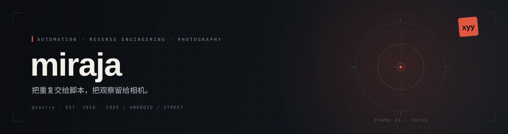
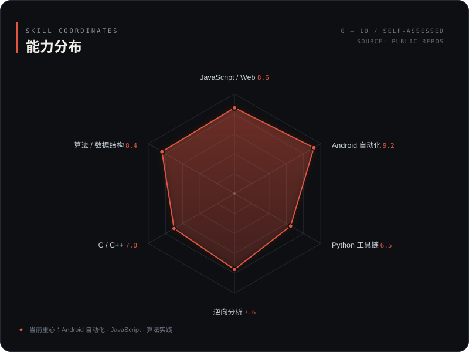

  

 

  
  
  
  
  
  
  
  
  

---

<h2 align="center">01 · 关于</h2>

写代码，也拍街头。

把重复的事情交给脚本，把观察留给相机。喜欢安静、可靠的工具，也喜欢有颗粒感的照片和旧书。

- **现在** — 维护 [xyy_max](https://github.com/xairry/xyy_max)：AutoJS 自动化脚本，以及 JS bundle 的还原与整理。
- **曾经** — PAT 甲级 / 乙级刷题（C++ / Java）；给小米 Note 刷 MoKee。
- **长期** — 街头摄影、心理学与旧约神学。

---

<h2 align="center">02 · 技能坐标</h2>

  

  <b>Android 自动化</b> AutoJS / Hamibot · HID · OCR 
  <b>JavaScript</b> webpack bundle · 静态站点 
  <b>逆向分析</b> 混淆还原 · 接口梳理 
  <b>算法</b> PAT 甲级 / 乙级 &nbsp;&nbsp; <b>工具</b> Python · Git · Linux

---

<h2 align="center">03 · 兴趣坐标</h2>

<table>
  <tr>
    <td align="center" width="33%">
       
      <b>摄影</b> 
      街头 · 黑白 · 颗粒
    </td>
    <td align="center" width="33%">
       
      <b>阅读</b> 
      心理学 · 神学
    </td>
    <td align="center" width="33%">
       
      <b>折腾</b> 
      刷机 · 系统 · 工具
    </td>
  </tr>
  <tr>
    <td valign="top">森山大道《北海道》与荒木经惟《感伤之旅》是我的街头启蒙。喜欢高反差、粗颗粒，以及照片里那点不确定。</td>
    <td valign="top">书架上长期放着 DSM-5 与霍志恒《旧约神学》。一个教我理解人，一个教我理解文本。</td>
    <td valign="top">给小米 Note 刷过 MoKee（Android 10），写过完整刷机笔记。脚本、构建、拆包，都是同一种好奇心。</td>
  </tr>
</table>

---

<h2 align="center">04 · 精选项目</h2>

| 项目 | 内容 | 栈 |
| :--- | :--- | :--- |
| **[xyy_max](https://github.com/xairry/xyy_max)** | AutoJS 自动化脚本集合；已移除登录与远程下发，仅供学习 | `JavaScript` |
| **[pat_advanced](https://github.com/xairry/pat_advanced)** | PAT 甲级题解：从 A+B 到图与树 | `C++` |
| **[PAT-Basic](https://github.com/xairry/PAT-Basic)** | PAT 乙级题解与练习 | `C++` `Java` |
| **[xairry.github.io](https://github.com/xairry/xairry.github.io)** | Hexo 博客归档：摄影 / 心理学 / 神学 / 折腾 | `HTML` |

---

<h2 align="center">05 · 最近在做什么</h2>

- 整理 `xyy_max` 的模块与构建脚本，让它能直接跑起来。
- 重读 DSM-5 与《旧约神学》的笔记。
- 整理博客里的《北海道》与《感伤之旅》图集。

  
  把重复交给脚本，把观察留给相机。 
  © 2026 miraja · <a href="https://github.com/xairry">GitHub</a> · <a href="https://github.com/xairry/xairry.github.io">博客归档</a>

